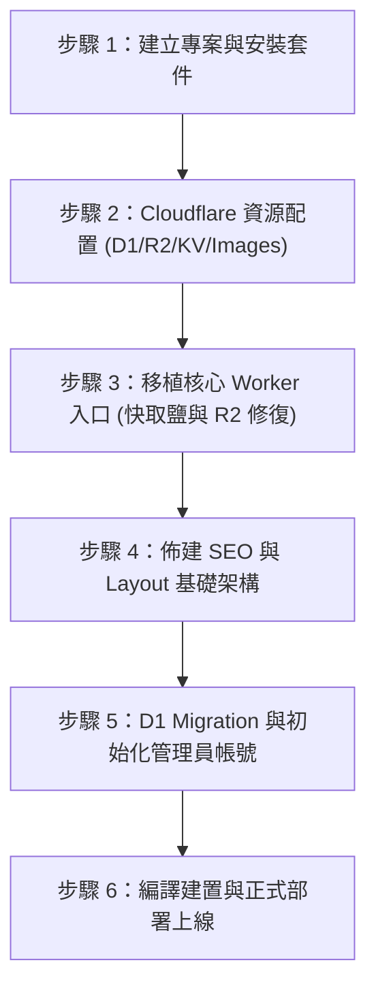

# EmDash + Cloudflare Workers 維運手冊與通用部署指南

> 本手冊為《風味洞察 Flavor Insight》實戰架構總結，包含當前站點的運維指令、重要網址，以及下次建立全新 EmDash 站點時可直接複製套用的**「標準化通用部署流程」**。

---

## 📌 第一部分：當前站點資訊與維運指令

### 1. 核心網址清單

| 環境 | 類型 | 網址 / 路徑 | 說明 |
| :--- | :--- | :--- | :--- |
| **遠端正式站** | **前台首頁** | `https://flavorinsight.com` | 自訂網域（經 Cloudflare CDN） |
| **遠端正式站** | **備用網址** | `https://flavorinsight.applecat69.workers.dev` | Cloudflare Workers 預設原生網址 |
| **遠端正式站** | **後台管理登入** | `https://flavorinsight.com/_emdash/admin` | 管理後台登入入口（或 `/_emdash/auth/login`） |
| **遠端正式站** | **文章管理列表** | `https://flavorinsight.com/_emdash/admin/content/posts` | 建立、編輯、發佈文章 |
| **遠端正式站** | **媒體庫** | `https://flavorinsight.com/_emdash/admin/media` | R2 媒體圖檔與音訊管理 |
| **遠端正式站** | **SEO 與全站設定** | `https://flavorinsight.com/_emdash/admin/settings` | 網站名稱、標語、作者、SEO 預設 |
| **本地開發端** | **專案本機目錄** | `/Users/austin/Desktop/EmDash Sites/flavorinsight` | 本機 Astro + EmDash 程式碼目錄 |
| **本地開發端** | **本地前台** | `http://localhost:4321` | 本地開發預覽首頁 |
| **本地開發端** | **本地後台** | `http://localhost:4321/_emdash/admin` | 本地 miniflare SQLite 後台 |

---

### 2. 本地端終端機操作指令

所有指令請在終端機進入專案目錄後執行：
```bash
cd "/Users/austin/Desktop/EmDash Sites/flavorinsight"
```

#### ① 本地開發伺服器運行
```bash
npm run dev
```
* 啟動後在瀏覽器開啟 `http://localhost:4321` 即可進行即時熱重載開發。

#### ② 關閉本地伺服器
* **正常關閉**：在正在執行 `npm run dev` 的終端機視窗中按下 **`Ctrl + C`**。
* **強制關閉背景佔用 Port 4321 的行程**（若遇到 Port 衝突）：
  ```bash
  kill -9 $(lsof -t -i:4321)
  ```

#### ③ 本地完整編譯測試（檢查 TypeScript 與 Astro 語法）
```bash
npm run build
```

#### ④ 線上 Cloudflare Workers 生產部署
```bash
npm run deploy
# 相當於執行: astro build && wrangler deploy
```

#### ⑤ 遠端正式資料庫 ➔ 一鍵同步回本地 SQLite
```bash
npm run db:pull
# 自動將線上 D1 最新的文章、標籤、分類、SEO 設定同步覆蓋至本機 SQLite
```

#### ⑥ 本地 Git 版本控制
```bash
# 檢視修改狀態
git status

# 提交更新
git add .
git commit -m "feat: 你的更新說明"

# (選用) 強制同步推送到 GitHub 遠端儲存庫
git push -u origin main --force
```

---

## 🛠️ 第二部分：核心技術沉澱與架構避坑指南

撇開純 CSS/版面樣式不論，本專案在 Cloudflare Workers、D1、R2、SEO 與 Astro 架構層面解決了多個關鍵技術難題：

### 1. Cloudflare Edge Cache「版本鹽（Version Salt）」快取穿透機制
* **問題**：Cloudflare Workers 採用分散式邊緣節點，使用 `caches.default` 快取前台 HTML 時，後台修改設定或文章，容易被邊緣節點（Isolates）的舊快取阻擋，前台訪客持續看到舊版。
* **架構解法（位於 `src/worker.ts`）**：
  * 在 Worker 入口針對快取 Request Key 追加版本鹽參數：
    ```ts
    const cacheKeyUrl = new URL(url.toString());
    cacheKeyUrl.searchParams.set("__cfv", "44"); // 每次重大改版推進此數字
    const cacheKey = new Request(cacheKeyUrl.toString(), {
        method: "GET",
        headers: { "accept": request.headers.get("accept") || "*/*" },
    });
    ```
  * **成果**：只要推進 `__cfv` 版本號（如 `v43 -> v44`）並執行 `npm run deploy`，全球所有 Cloudflare 節點的 Edge Cache 瞬間失效並重新抓取最新 HTML，完全不需手動去 Cloudflare 儀表板執行全站 Purge Cache！
  * **安全邊界**：嚴格限制只對 `GET` / `HEAD` 生效，且對 `/_emdash/admin`、`/_emdash/auth`、`/_emdash/api/` 等後台與驗證路徑**完全繞過快取**。

---

### 2. R2 裸媒體 ID（Bare Media ID）自動降級解析
* **問題**：EmDash 透過 Seed 或資料庫匯入時，文章或 SEO 欄位經常儲存不帶副檔名的純 ID（如 `01M59MGY...`），但 R2 儲存空間實際上存的是 `01M59MGY....jpg`。直接請求 `/_emdash/api/media/file/<id>` 會產生 404，導致 SEO 面板出現「Image not found」。
* **架構解法（位於 `src/worker.ts`）**：
  * 攔截 `/_emdash/api/media/file/` 請求：
  * 若底層儲存回傳 404，Worker 會自動查詢 D1 的 `media` 表：
    `SELECT storage_key, mime_type FROM media WHERE id = ?`
  * 抓到真實的 `storage_key` 後直接從 R2 Bucket 串流輸出圖檔，徹底消除 404 圖片破圖。

---

### 3. D1 遠端至本地資料庫同步（繞過 FTS5 導出限制）
* **問題**：官方 `npx wrangler d1 export --remote` 指令遇到 SQLite FTS5（全文檢索虛擬表）時，會直接報錯中斷：
  `✘ [ERROR] D1 Export error: cannot export databases with virtual tables (like FTS5)`
* **架構解法（位於 `scripts/sync-remote-to-local.py`）**：
  * 針對實體資料表（`ec_posts`, `taxonomies`, `content_taxonomies`, `options`, `users`, `media`, `_emdash_seo` 等）逐一以 JSON 批次提取。
  * 寫入本地 SQLite 前，動態備份並卸載所有 `BEFORE/AFTER INSERT` 觸發器（避免 `media usage capture inactive` 觸發器中斷）。
  * 注入資料後重建觸發器，並執行 `INSERT INTO _emdash_fts_posts(_emdash_fts_posts) VALUES('rebuild')` 重建全文檢索索引。

---

### 4. 國際化標準 SEO 與 AI 知識圖譜（Topic Clusters）
* **JSON-LD Schema**：
  * 在 `<head>` 注入完整的 Schema.org `@graph` 陣列，包含 `Person`（Austin 作為獨立觀察者）、`WebSite`、`Blog`、`BlogPosting` 與 `BreadcrumbList`。
* **網址語義化與 301 永久重定向**：
  * 文章 Slug 由無意義的代碼（如 `smoothtripml1`）全面升級為語意清晰、受眾搜尋量高的英文短網址（如 `malaysia-ktm-train-guide`）。
  * 為了保證舊外鏈與歷史讀者不丟失，在 [`astro.config.mjs`](file:///Users/austin/Desktop/EmDash%20Sites/flavorinsight/astro.config.mjs) 的 `redirects` 模組中建立對照表，達成 100% 搜尋權重繼承。

---

## 🚀 第三部分：全新 EmDash 站點極速安裝通用流程說明書（SOP）

當您未來要建立另一個全新 EmDash 站點時，依照以下 6 個標準步驟，即可在 15 分鐘內完成從零到上線的完整部署：



---

### 步驟 1：建立 Astro 專案並安裝 EmDash 核心與外掛
```bash
# 1. 建立空 Astro 專案
npm create astro@latest my-new-blog -- --template minimal --typescript strict --install --no-git
cd my-new-blog

# 2. 安裝 Astro Cloudflare 介面卡與 React
npx astro add cloudflare react -y

# 3. 安裝 EmDash 核心與 Cloudflare 驅動
npm install emdash @emdash-cms/cloudflare

# 4. 安裝常用外掛（SEO、閱讀時間、短網址、顏色標記等）
npm install @jdevalk/emdash-plugin-seo @plugdash/readtime @plugdash/shortlink @plugdash/tocgen @plugdash/callout @plugdash/sharepost emdash-author-box
```

---

### 步驟 2：Cloudflare 雲端資源建立（Wrangler）
在終端機登入 Cloudflare 並建立四大基礎設施：

```bash
# 1. 建立 D1 資料庫
npx wrangler d1 create my-new-blog-db
# (記下輸出的 database_id)

# 2. 建立 R2 儲存空間（媒體庫）
npx wrangler r2 bucket create my-new-blog-media

# 3. 建立 KV 空間（Session 登入狀態）
npx wrangler kv namespace create SESSION
# (記下輸出的 kv_id)
```

在專案根目錄的 `wrangler.jsonc` 配置綁定：
```jsonc
{
  "$schema": "node_modules/wrangler/config-schema.json",
  "name": "my-new-blog",
  "main": "dist/server/entry.mjs",
  "compatibility_date": "2026-08-01",
  "compatibility_flags": ["nodejs_compat"],
  "d1_databases": [
    {
      "binding": "DB",
      "database_name": "my-new-blog-db",
      "database_id": "<填入你的_database_id>"
    }
  ],
  "r2_buckets": [
    {
      "binding": "MEDIA",
      "bucket_name": "my-new-blog-media"
    }
  ],
  "kv_namespaces": [
    {
      "binding": "SESSION",
      "id": "<填入你的_kv_id>"
    }
  ],
  "images": {
    "binding": "IMAGES"
  },
  "assets": {
    "directory": "dist/client"
  }
}
```

---

### 步驟 3：複製最佳實踐的 Worker 入口 (`src/worker.ts`)
直接建立 `src/worker.ts`，並複製包含以下能力的程式碼：
1. `__cfv` 快取版本鹽（Cache Version Salt）。
2. 後台與認證 API 嚴格繞過快取。
3. R2 媒體裸 ID（Bare ID）404 自動補查資料庫機制。
4. 安全性 Headers（`nosniff`, `SAMEORIGIN`）。

---

### 步驟 4：設定 Astro 配置與語言環境 (`astro.config.mjs`)
在 `astro.config.mjs` 中設定：
```javascript
import { defineConfig } from "astro/config";
import cloudflare from "@astrojs/cloudflare";
import react from "@astrojs/react";
import emdash from "emdash/astro";
import { seoPlugin } from "@jdevalk/emdash-plugin-seo";
import { readtimePlugin } from "@plugdash/readtime";

export default defineConfig({
  site: "https://your-domain.com",
  output: "server",
  adapter: cloudflare(),
  i18n: {
    defaultLocale: "zh-TW",
    locales: ["zh-TW"],
    routing: { prefixDefaultLocale: false }
  },
  integrations: [
    react(),
    emdash({
      plugins: [seoPlugin(), readtimePlugin()]
    })
  ]
});
```

---

### 步驟 5：初始化資料庫與管理員帳號
```bash
# 1. 執行 EmDash 資料庫遷移（在遠端 D1）
npx wrangler d1 execute my-new-blog-db --remote --file=node_modules/emdash/dist/migrations/000_init.sql

# 2. 或者直接以 seed.json 進行初始化導航與分類建立
npx emdash seed
```

---

### 步驟 6：編譯建置與一鍵部署
```bash
# 本地建置驗證
npm run build

# 正式推送到 Cloudflare 生產環境
npx wrangler deploy
```
部署完成後：
* 進入 `https://your-domain.com/_emdash/admin` 即可完成初次管理員密碼設定並開始寫作！
